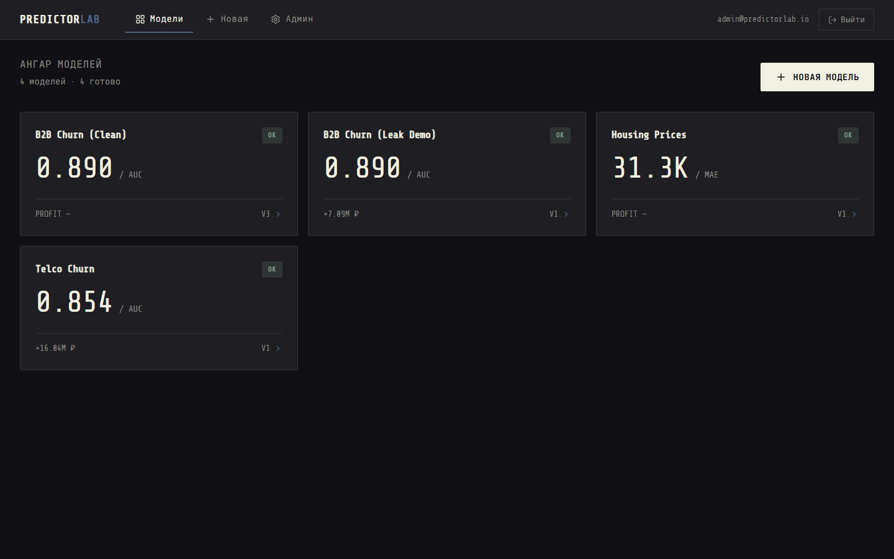
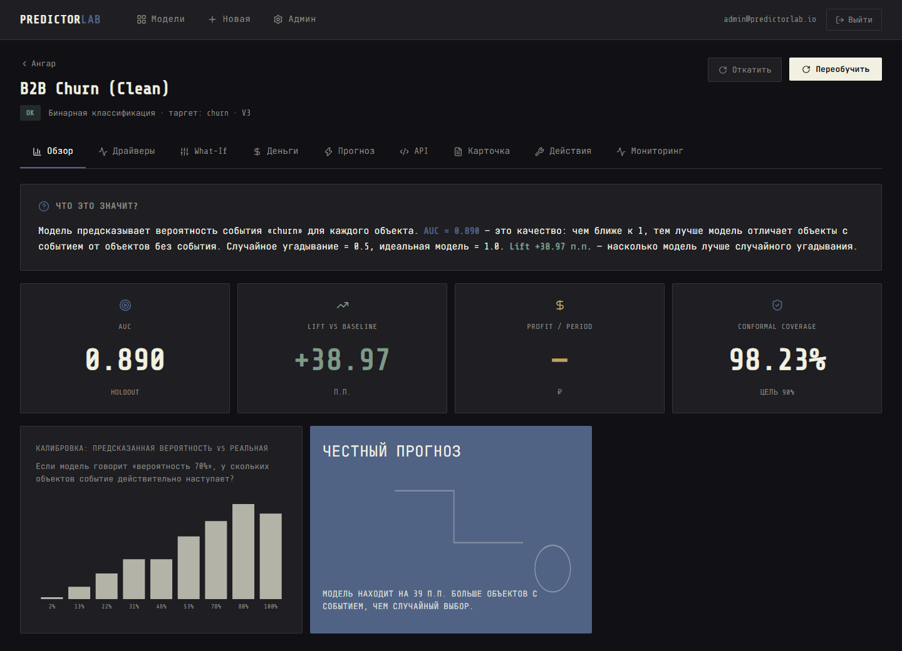
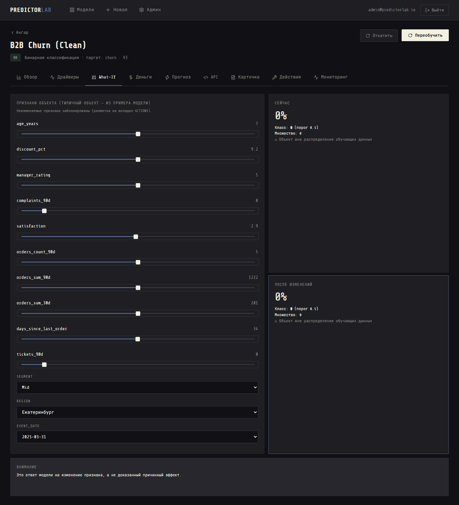
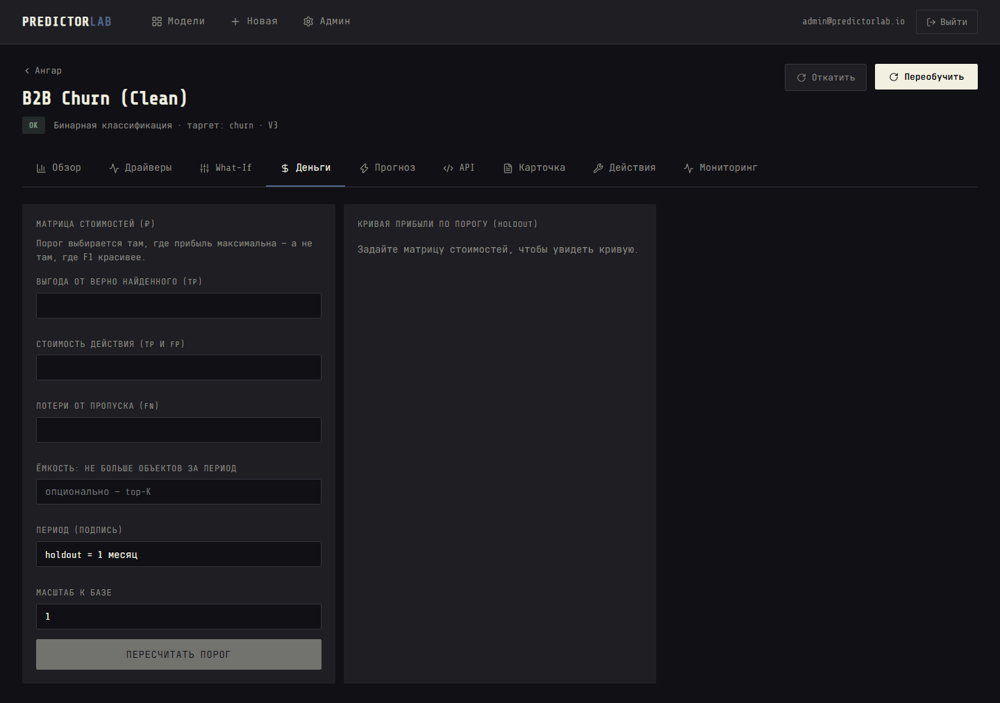
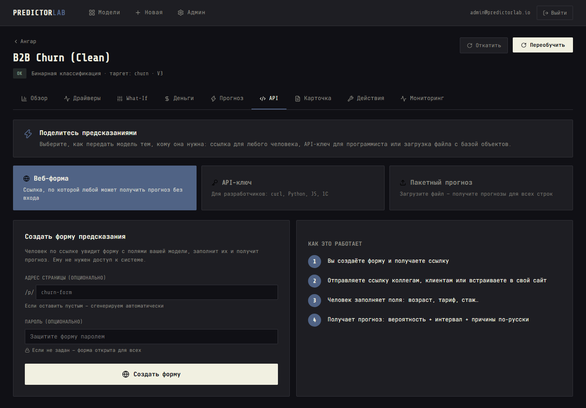
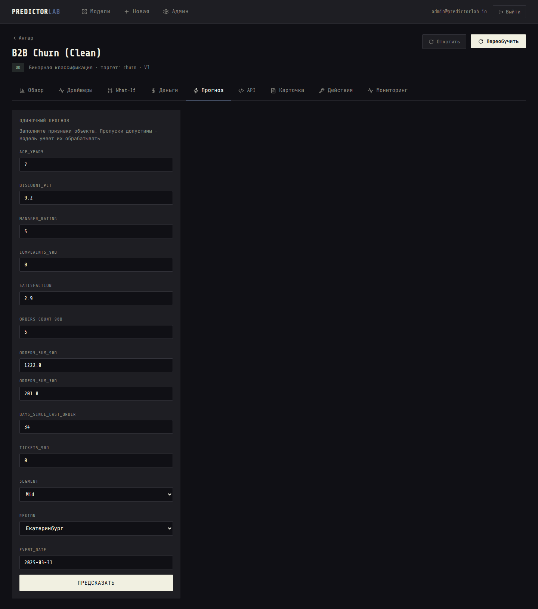
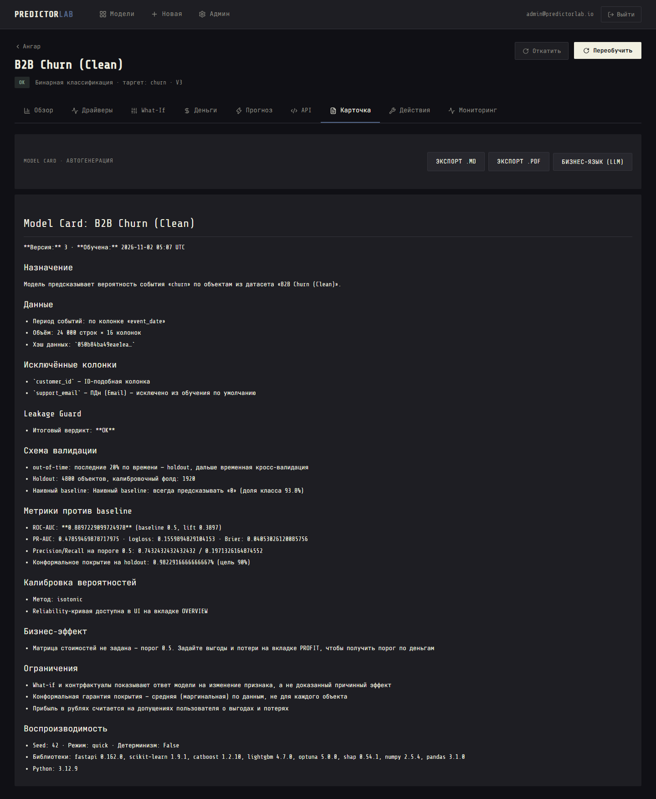

# PredictorLab

**English** | [Русский](README.ru.md)


[](../../actions/workflows/ci.yml)
[](../../actions/workflows/nightly.yml)

> Upload your data. Say what you want to predict. Get an honest model with a confidence interval,
> a profit-optimized threshold, and a REST API — in 5 minutes. No Data Science team required.

**PredictorLab** is self-hosted tabular ML that doesn't lie to you.
It catches target leakage before the model trains on it. It splits time-series data by time, not by accident.
It gives you a conformal interval — not just a bare probability. And it picks the decision threshold
that maximizes your money, not F1.

**Spoiler:** the model that shows 99% accuracy on your first upload is almost certainly broken.
This tool will tell you exactly why — and fix it for you.



---

## The Problem

I've watched this scenario play out dozens of times:

1. A business team uploads a customer churn dataset to a "no-code ML" tool
2. They get **ROC-AUC 0.98** — everybody celebrates
3. The model goes to production, predicts nothing useful, and dies quietly

The 0.98 was never real. The dataset had a `cancel_date` column — filled in only after a customer
had already churned. The model learned to read the future, not to predict it. Every no-code tool
I've tried either doesn't detect this, or hides the problem behind a yellow warning icon that
nobody clicks.

**The second problem** is even more insidious: even with a "good" model, business people get
probabilities — not decisions. "This customer has a 73% churn probability." Great. What do I *do*
with that? Call them? Offer a discount? The tool never says, because the tool doesn't know
what a phone call costs or what a saved customer is worth.

**PredictorLab solves both:**

| Problem | How every tool handles it | How PredictorLab handles it |
|---------|--------------------------|----------------------------|
| Target leakage | Doesn't detect it → "99% accuracy!" | **Leakage Guard**: 9 deterministic checks, BLOCK verdict with plain-language explanation, "Exclude and retrain" button |
| Random split on time-series data | Random split → train/test contamination | **Automatic out-of-time split** when a date column exists + group split by entity |
| Bare probability with no measure of uncertainty | "73% churn probability" (and then what?) | **Conformal prediction**: interval [lo, hi] for regression, prediction set for classification + OOD flag |
| Threshold at 0.5 or by F1 | "Here's your AUC, good luck" | **Cost matrix → profit-maximizing threshold**: "At threshold 0.27, treating the top-500 customers nets you +84,000₽/month vs random" |
| No actionable next step | "Here are your SHAP values" | **Counterfactuals**: "Reduce this customer's discount by 5% → churn probability drops from 0.81 to 0.31, cost: 3,000₽, ROI: 21,400₽" |
| Dead model after training | One-and-done | **Monitoring**: PSI drift detection, live metrics on real outcomes, webhooks, one-click retraining |

---

## How it looks

**Leakage Guard in action** — the killer feature. Upload the leaky demo dataset, and the system
doesn't just warn — it refuses to show results and tells you what to do:



*The "What does this mean?" block explains AUC, lift, and conformal coverage in business terms — not jargon.*

**Training panel** — real-time SSE progress, 7 stages with descriptions, live leaderboard, elapsed/remaining time:



**Profit optimization** — the threshold is set where your money is maximized, not where F1 looks pretty:



**Sharing predictions** — three ways, each one click. Web form for non-technical users, API key for developers, batch for processing your entire customer base:



**Single prediction** — probability, conformal interval, reasons in plain language, OOD flag:



**Model Card** — auto-generated with leakage report, assumptions, limitations. Exportable to Markdown and PDF:



---

## How it works

```
  ┌────────────────── Web Interface ──────────────────┐
  │  React UI ←SSE→ FastAPI + asyncio jobs + ProcessPool │
  │         │                                          │
  │         │   ┌─────── REST API :8000 ────────┐      │
  │         │   │  /api/v1/models/{id}/predict  │      │
  │         │   │  /api/v1/models/{id}/whatif   │      │
  │         │   │  /api/v1/jobs/{id}            │      │
  │         │   └───────────────────────────────┘      │
  │         │                                          │
  │         │   ┌─────── MCP Server :8100 ──────┐      │
  │         │   │  predict, explain, what_if,   │      │
  │         │   │  counterfactual, model_card   │      │
  │         │   └───────────────────────────────┘      │
  │         │                                          │
  │         ▼                                          │
  │  ┌─── Core Pipeline ──────────────────────────┐    │
  │  │                                            │    │
  │  │  CSV/XLSX/Parquet ← PII scanner            │    │
  │  │       ↓                                    │    │
  │  │  Feature Builder (point-in-time SQL)       │    │
  │  │       ↓                                    │    │
  │  │  Leakage Guard (9 deterministic checks)    │    │
  │  │       ↓                                    │    │
  │  │  Splits (OOT / group / stratified)         │    │
  │  │       ↓                                    │    │
  │  │  Training (CatBoost + LightGBM + Optuna)    │    │
  │  │       ↓                                    │    │
  │  │  Calibration + Conformal + OOD + SHAP       │    │
  │  │       ↓                                    │    │
  │  │  Profit → Threshold → Counterfactuals       │    │
  │  │       ↓                                    │    │
  │  │  Monitoring (PSI drift + live metrics)      │    │
  │  │                                            │    │
  │  └────────────────────────────────────────────┘    │
  │                                                    │
  │  DuckDB (data) · SQLite (metadata) · joblib       │
  │  PostgreSQL / MySQL / ClickHouse / SQLite (RO)     │
  └────────────────────────────────────────────────────┘
```

1. **Upload** CSV, XLSX or Parquet — encoding and delimiter detected automatically (including cp1251).
   PII columns (email, phone, INN, SNILS, passport, card) are detected and **excluded from training by default**.
2. **Pick a target** — from a dropdown or describe it in words (LLM suggests the column and SQL).
3. **Leakage Guard** runs 9 deterministic checks. If BLOCK — you see exactly which columns leak and why.
   One click: "Exclude and retrain". Advanced users can override (recorded in Model Card).
4. **Train** — Quick (CatBoost + linear, ~2 min) or Full (Optuna searches CatBoost + LightGBM within a time budget).
   Watch live progress: stages, candidate leaderboard, elapsed time.
5. **Result** — AUC/MAE vs baseline, conformal coverage, calibration curve, SHAP drivers.
   Set the cost matrix → profit curve → optimal threshold. Try What-If sliders.
6. **Share** — create a web form link, an API key, or batch-predict an entire file.
7. **Monitor** — PSI drift alerts, live metrics on real outcomes, webhooks, one-click retrain.

---

## Leakage Guard: the demo that sells the product

The `demo-data/b2b_leaky.csv` dataset contains a deliberate trap:
`cancel_date` is filled only for customers who already churned. Here's what happens:

```
Leakage Guard — Verdict: BLOCK

[x] cancel_date almost perfectly predicts the target (AUC 0.998).
    Value appears to be known only after the event has occurred.
[x] final_status: column name resembles a post-event feature.
[x] cancel_date contains dates after the event time (100% of rows) — feature from the future.

Results will not be shown.
[ Exclude (cancel_date, final_status) and retrain ]
```

After "Exclude and retrain", AUC drops to **0.85**. That's the real model.
It's still good — but it's honest. The 0.998 was never yours.

---

## Quick Start

```bash
git clone https://github.com/MarkIvor/predictorlab.git
cd predictorlab
cp .env.example .env    # change ADMIN_EMAIL / ADMIN_PASSWORD / secrets
docker compose up -d
```

| | |
|---|---|
| UI | http://localhost:3000 |
| API | http://localhost:8000 |
| OpenAPI docs | http://localhost:8000/docs |

Default admin is created from `.env` on first boot. Password change is required on first login.

**Dev without Docker:**
```bash
python -m venv .venv && .venv/bin/pip install -r backend/requirements.txt
cd backend && uvicorn app.main:app --port 8000
# second terminal:
cd frontend && npm install && npm run dev
```

**Works fully offline and without LLM.** When `LLM_BASE_URL` is empty, all LLM features are hidden.
Training, predictions, intervals, thresholds — everything is deterministic code.
LLM is only for: natural-language target suggestion, semantic column checking, and Model Card text.
Raw data rows never leave the system (enforced by code + tested by a spy test).

---

## Predict in 60 seconds

```bash
# Create a key in the UI (API tab) — shown once, stored as SHA-256 hash
export KEY=pl_live_...

# Get the model's input schema
curl http://localhost:8000/api/v1/models/1/schema -H "Authorization: Bearer $KEY"

# Predict with reasons
curl -X POST http://localhost:8000/api/v1/models/1/predict \
  -H "Authorization: Bearer $KEY" -H "Content-Type: application/json" \
  -d '{"data": [{"days_since_last_order": 75, "satisfaction": 2.1}], "include": ["reasons"]}'
```

Response:
```json
{
  "predictions": [{
    "prediction_id": "prd_01J...",
    "label": "churn",
    "probability": 0.81,
    "decision": true,
    "threshold": 0.27,
    "conformal": {"coverage": 0.9, "prediction_set": ["churn"]},
    "out_of_distribution": false,
    "top_reasons": [
      {"feature": "days_since_last_order", "value": 75,
       "text": "No orders in 75 days: +18pp to risk"}
    ]
  }],
  "latency_ms": 62
}
```

Snippets for **curl, Python, JavaScript, and 1C** are auto-generated per model schema — they work without edits.

---

## Share predictions

| Method | What it is | For whom |
|--------|-----------|----------|
| **Web form** | One click → shareable URL. Anyone can predict without login. Optional password. | Colleagues, clients |
| **API key** | `pl_live_...` key with per-model access, hash-stored, shown once | Developers |
| **Batch** | Upload CSV → background job → download predictions with intervals | Processing the full customer base |
| **MCP** | `predict`, `explain`, `what_if`, `counterfactual`, `get_model_card`, `get_drift_status` — right in Claude Desktop or Cursor | AI power users |

---

## What-If and Counterfactuals

**What-If sliders** let you change any feature and watch the prediction and interval recalculate in real time
(150ms debounce). A permanent disclaimer: *"This is the model's response to a feature change, not a proven causal effect."*

**Counterfactuals** go further: they find the **minimum-cost change** to actionable features
that flips the prediction across the threshold. You define: allowed range, direction (only up / only down),
and cost per unit of change. The system searches (greedy + random restarts, with a timeout)
and returns:

```
Action: reduce discount_pct from 12% to 5%
Cost: 3,000 ₽
Probability before: 0.81 → after: 0.31
Expected ROI: 21,400 ₽
```

If the model says "change the customer's age" — it won't, because you marked it as immutable.

---

## Monitoring

After the model is in production:

- Every prediction is logged (PII masked, TTL configurable)
- **PSI drift** computed per feature and per prediction distribution (7/30-day windows)
- **Live metrics**: real AUC/MAE from feedback vs validation numbers
- **Webhooks** fire on DRIFT or live-metric drop
- **One-click retrain** on fresh data; version comparison and rollback

---

## Benchmarks

| Operation | Budget | Measured |
|---|---|---|
| `predict`, 1 record | < 300 ms | **62 ms** |
| `predict` + SHAP reasons | < 1 s | **79 ms** |
| Batch 10k rows | < 2 min | **14 s** |
| Train quick, 50k × 50 | ~2 min | **155 s** |
| Counterfactual, 1 object | < 10 s | **6.4 s** |

Full results: [BENCHMARKS.md](BENCHMARKS.md) · Run: `make bench`

---

## Tests & CI

```bash
make check     # lint + typecheck + unit + property + integration + llm + security + frontend (~2 min)
make test-e2e  # Playwright end-to-end
make test-ml   # ML quality: golden datasets, determinism, invariants
make bench     # performance benchmarks → BENCHMARKS.md
```

| Layer | Tools |
|-------|-------|
| Lint + format | ruff (check + format) |
| Typecheck | mypy (strict for `core/`) |
| Unit tests | pytest — 51 tests: guard, profit, conformal, splits, PII, sql_guard, counterfactuals, signing |
| Property tests | hypothesis — 12 tests: profit monotonicity, conformal coverage, PII masking, CF bounds |
| Integration | TestClient — upload → train → predict → batch → keys → 422 errors |
| LLM contract | mock client, fixtures, spy test ("raw rows don't leave"), number validator, causal-word stop-list |
| Security | key hash, 401/403, sql_guard DML/DDL/CTE injection, PII exclusion + masking |
| Frontend | vitest + eslint + tsc — 10 component tests |
| ML quality | golden datasets (Telco AUC range), leak detection, determinism, robustness, invariance |
| CI | GitHub Actions: ruff → mypy → tsc/eslint → pytest → coverage ≥ 60% → e2e smoke |

---

## Honesty & Limitations

- **Counterfactuals ≠ causality.** "Reduce discount → probability drops" is the model's response
  to a feature change, not proof that the discount caused the churn.
- **Conformal guarantee is marginal.** 90% coverage holds on average across predictions,
  not for every individual object. For heavily imbalanced classes, set coverage may exceed α —
  that's a mathematical property of the method (see [DECISIONS.md](DECISIONS.md) D-12).
- **Small datasets give wide intervals.** 200 rows → the interval is nearly useless.
  We show this honestly instead of hiding it behind a single number.
- **Profit in rubles is only as good as your assumptions.** All formulas and coefficients
  are expandable in the UI. The "+1.84M ₽" is true exactly to the extent your
  cost/benefit estimates are true.
- **LLM never affects the numbers.** Training, probabilities, intervals, thresholds, profit —
  all deterministic code. LLM writes texts only, and those pass a number validator
  that rejects any number not present in the computed fields.
- **Time-series forecasting (v0.3)** is pragmatic: lags + rolling stats + calendar features,
  one series at a time. Strong exotic seasonality is not modeled (DECISIONS.md D-10).

---

## Tech Stack

| Layer | |
|-------|-|
| Backend | Python 3.12, FastAPI, Pydantic v2, SSE, asyncio jobs + ProcessPool |
| ML | scikit-learn, CatBoost, LightGBM, Optuna, SHAP, own split-conformal |
| Data | DuckDB (data), SQLite (metadata), PostgreSQL / MySQL / ClickHouse / SQLite connectors (read-only) |
| Frontend | React 19, TypeScript, Vite, Recharts, CSS custom properties (no UI kits) |
| MCP | FastMCP (stdio + HTTP, Bearer auth) |
| Infra | Docker, docker-compose, GitHub Actions, pre-commit |
| Testing | pytest + hypothesis + vitest + Playwright + ruff + mypy + bandit |

---

## License

MIT — like all [Ivor's Lab](https://github.com/MarkIvor) repositories.

Telco Customer Churn © IBM (Apache 2.0 mirror), California Housing from A. Géron's course —
both included in `demo-data/` for offline demos.
