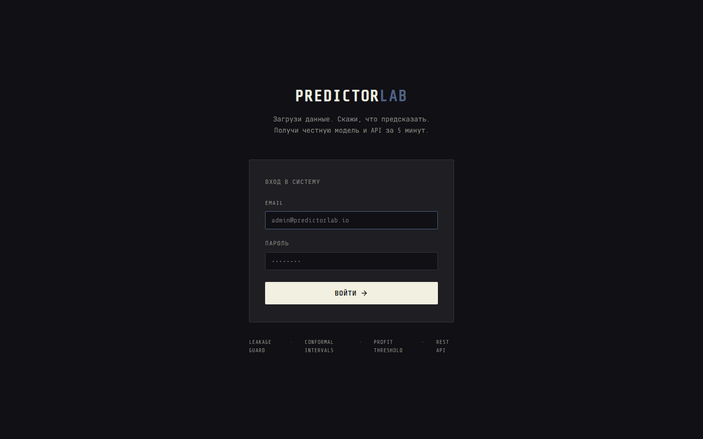
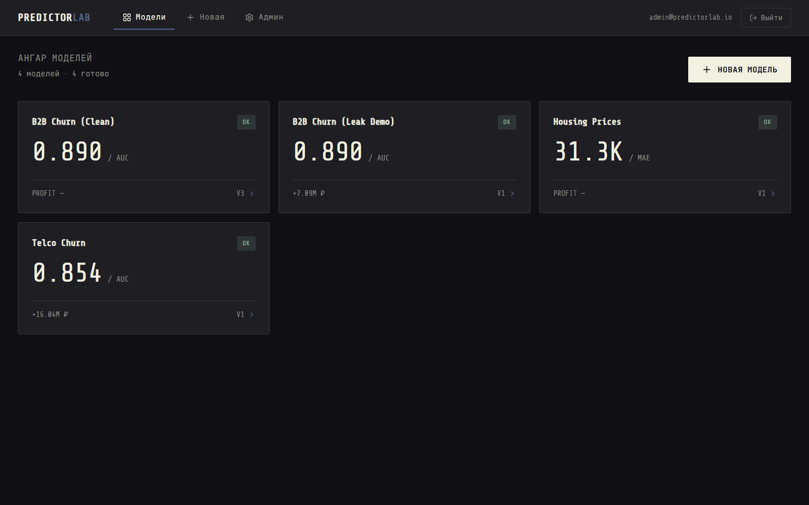
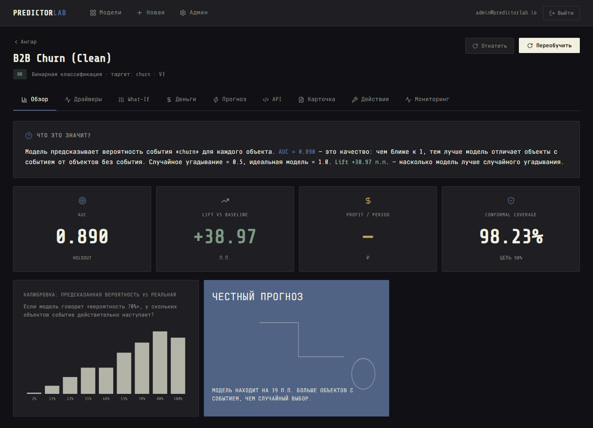
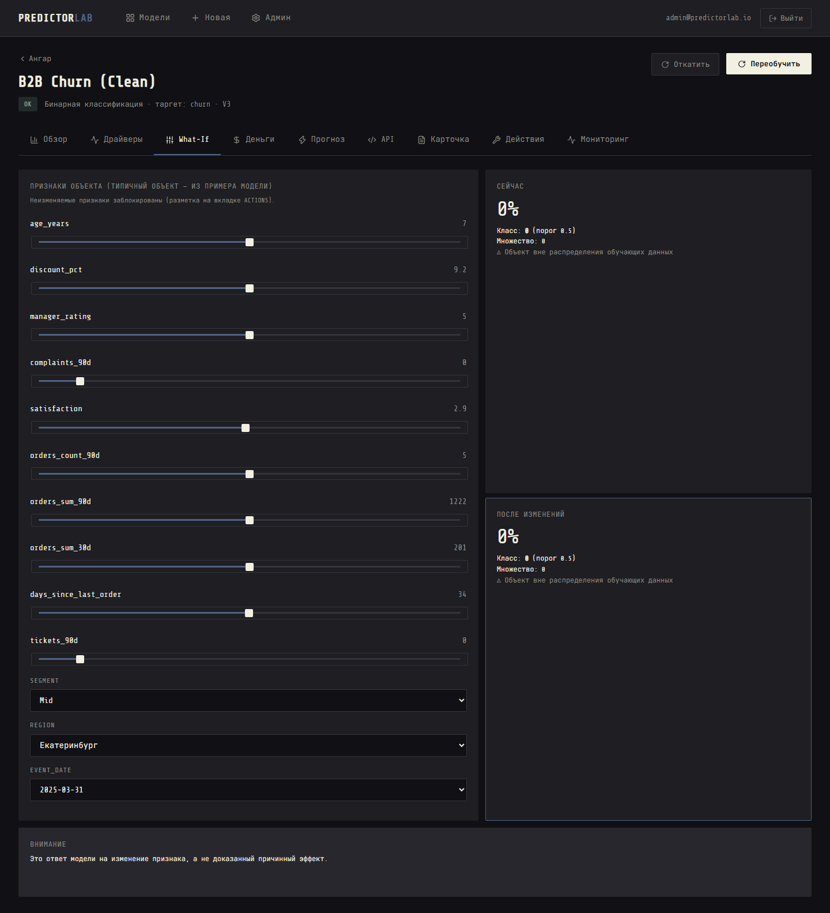
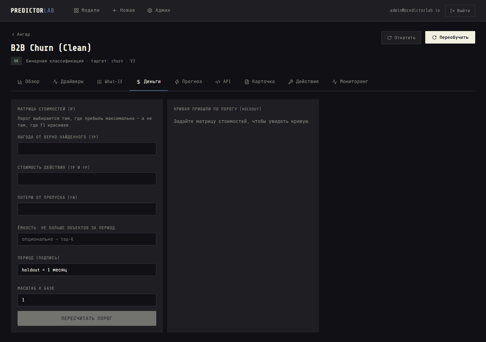
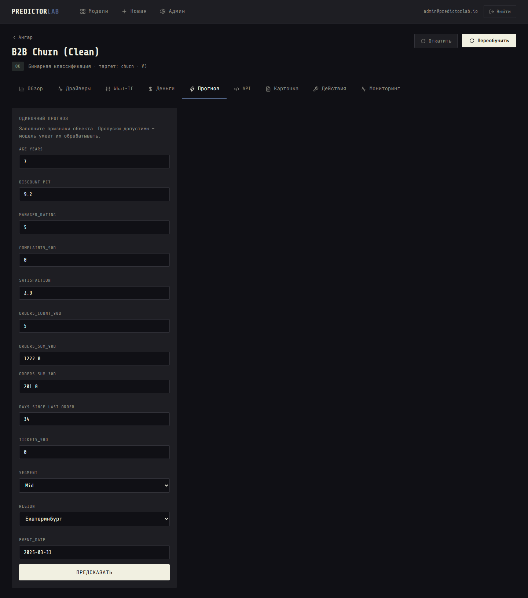
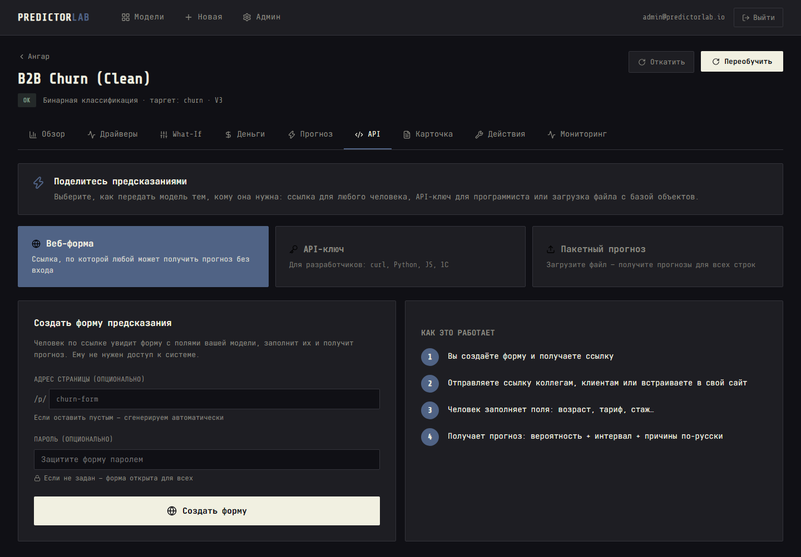
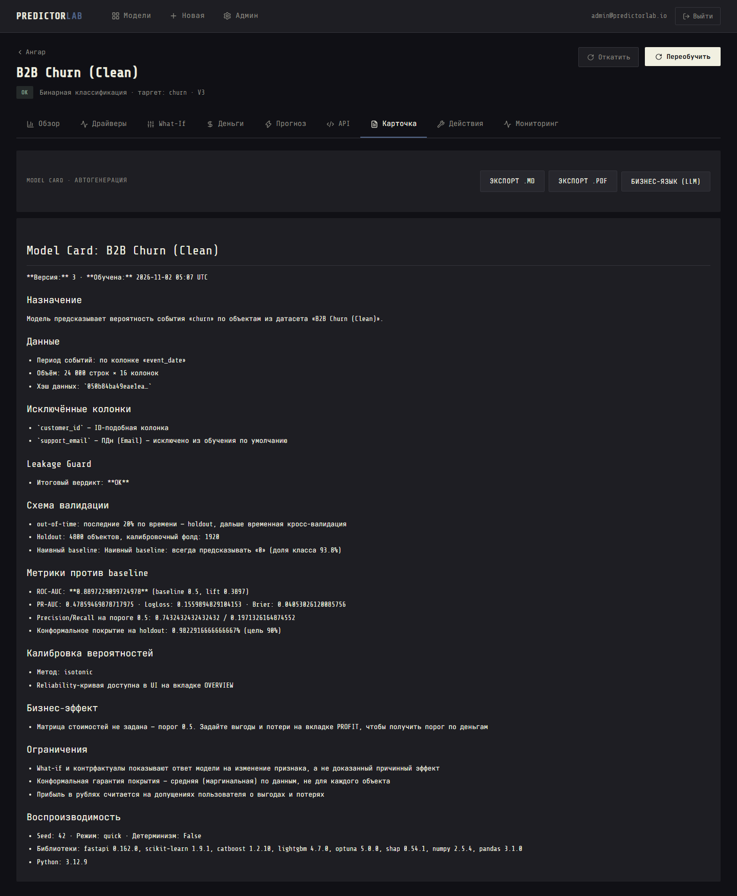
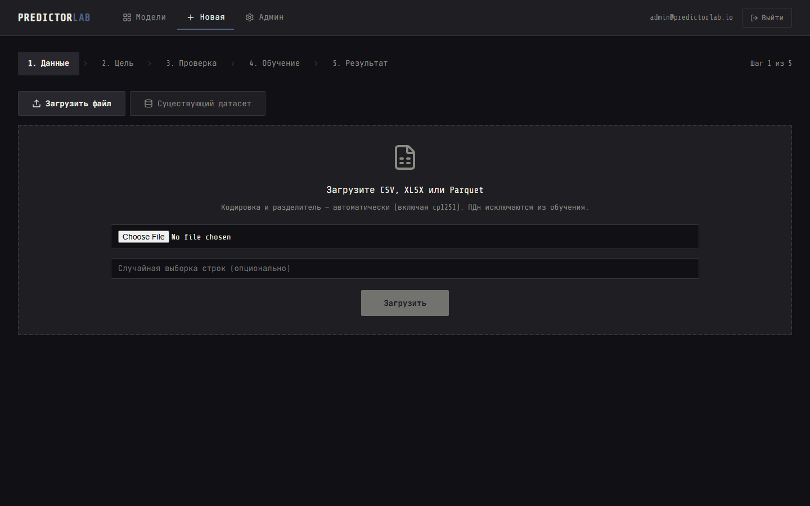
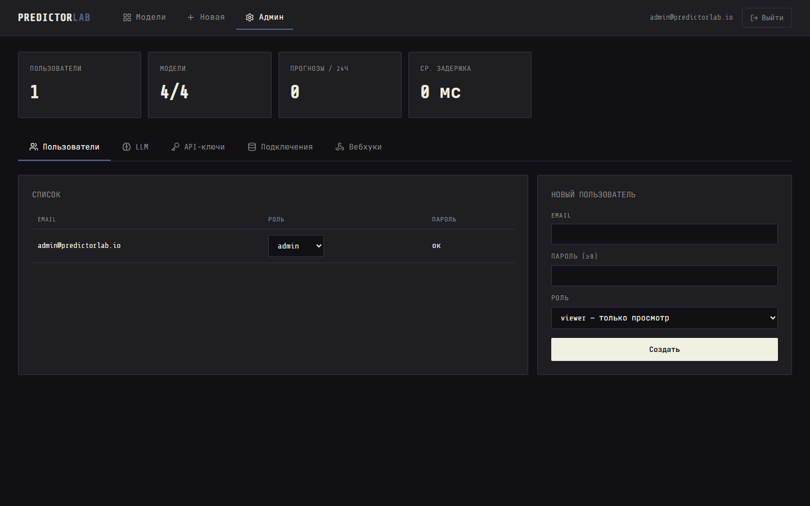

# PredictorLab

> Загрузи данные. Скажи, что хочешь предсказать. Получи честную модель, прогноз в рублях и API — за 5 минут.

**Self-hosted табличный ML для людей без Data Science.** Загрузил файл → выбрал цель → получил модель → предсказываешь через UI, файл, веб-форму или **REST API**. Система ловит **утечки целевой переменной**, честно режет выборку по времени, даёт **доверительные интервалы** и подбирает порог **по деньгам**, а не по F1.

[](https://github.com/MarkIvor/predictorlab/actions/workflows/ci.yml)
[](LICENSE)
[](https://www.python.org/downloads/)
[](https://react.dev)
[](https://docs.docker.com/compose/)

[English](README.md) · Русская версия

## Почему не Obviously AI / DataRobot / H2O?

| | Obviously AI | DataRobot / H2O | **PredictorLab** |
|---|---|---|---|
| Утечка таргета | Не видит — «99% точности» | Частично | **Leakage Guard: BLOCK + объяснение по-русски** |
| Доверительный интервал | Вероятность и всё | Зависит от модели | **Conformal: интервал/множество с гарантией покрытия + OOD-флаг** |
| Порог решения | 0.5 или F1 | Вручную | **Матрица стоимостей → порог по максимуму прибыли, top-K** |
| Сплит на временных данных | Случайный | Вручную | **Автоматический out-of-time + group split** |
| Витрина из БД | Нужен плоский файл | ETL отдельно | **Feature Builder: point-in-time SQL из вашей БД** |
| Что делать с прогнозом | — | — | **Контрфактуалы: минимальное по стоимости действие** |
| Self-hosted и офлайн | Нет | Да, но тяжело | **Docker, полная работа без LLM и интернета** |
| Цена | SaaS | $$$$ | **MIT** |

## Как это выглядит

| | |
|---|---|
|  |  |
| *Страница входа* | *Ангар моделей — AUC, прибыль, вердикт Guard* |
|  |  |
| *Обзор: «Что это значит?» + калибровка + драйверы* | *What-If: живые слайдеры, интервал пересчитывается* |
|  |  |
| *Деньги: матрица стоимостей → порог по деньгам* | *Прогноз: вероятность + интервал + причины* |
|  |  |
| *Поделиться: веб-форма, API-ключ, пакет — 3 пути* | *Model Card: авто-генерация, экспорт* |
|  |  |
| *Мастер 5 шагов: Данные → Цель → Проверка → Обучение → Результат* | *Админка: пользователи, LLM, подключения, вебхуки* |

## Как работает

```
 UI :3000 ████  REST API :8000 ████  MCP :8100
    │                     │                     │
    └─────────────────────┼─────────────────────┘
                          ▼
          ┌────────────────────────────────────┐
          │  FastAPI + asyncio-очередь + SSE     │
          ├────────────────────────────────────┤
          │  Инжест: CSV/XLSX/Parquet, ПДн       │
          │  Feature Builder: point-in-time      │
          │  Leakage Guard → сплиты → обучение   │
          │  CatBoost/LightGBM + Optuna          │
          │  Conformal + OOD + SHAP + Профит      │
          │  Мониторинг: PSI-дрейф + вебхуки      │
          ├────────────────────────────────────┤
          │  DuckDB (данные) · SQLite (метаданные)│
          │  storage/models/{id}/v{n}/ артефакты  │
          └────────────────────────────────────┘
```

## Leakage Guard: как выглядит спасённый проект

Загружаем синтетический B2B с подставой — колонка `cancel_date` заполнена только у ушедших:

```
[x] «cancel_date» почти идеально предсказывает таргет (AUC 0.998) — похоже на утечку
[x] Название «final_status» похоже на признак, который известен только ПОСЛЕ события
[x] «cancel_date» содержит даты позже времени события (100% строк) — признак из будущего

Вердикт: BLOCK — результаты показаны не будут
[ИСКЛЮЧИТЬ (cancel_date, final_status) И ПЕРЕОБУЧИТЬ]
```

После «Исключить и переобучить» ROC-AUC честно опускается с ~0.99 до ~0.85 — это **настоящая** модель, а не артефакт утечки. Опытный пользователь может снять блок осознанно (чекбокс) — решение фиксируется в Model Card.

## Быстрый старт

```bash
git clone https://github.com/MarkIvor/predictorlab.git
cd predictorlab
cp .env.example .env    # поменяйте ADMIN_EMAIL / ADMIN_PASSWORD / секреты
docker compose up -d
# UI: http://localhost:3000  ·  API: http://localhost:8000  ·  /docs
```

**Dev без Docker:**
```bash
python -m venv .venv && .venv/bin/pip install -r backend/requirements.txt
cd backend && uvicorn app.main:app --port 8000
cd frontend && npm install && npm run dev
```

Дальше: войдите дефолтным админом (при первом входе пароль меняется), загрузите `demo-data/telco.csv` или `demo-data/b2b_leaky.csv` (с подставой — проверьте Leakage Guard), выберите таргет, нажмите **Быстро**.

**Полная работа офлайн и без LLM.** При пустом `LLM_BASE_URL` LLM-функции скрыты — обучение и прогнозы не зависят от внешних сервисов. LLM (любой OpenAI-совместимый API) подключается в админке и используется только для текстов, предложений по фичам и семантической проверки колонок — сырые строки данных не уходят.

## Прогноз за 60 секунд

```bash
# 1. Создайте ключ в UI (вкладка API): показывается один раз, хранится хэшем
export KEY=pl_live_...

# 2. Схема модели
curl http://localhost:8000/api/v1/models/1/schema -H "Authorization: Bearer $KEY"

# 3. Прогноз с причинами
curl -X POST http://localhost:8000/api/v1/models/1/predict \
  -H "Authorization: Bearer $KEY" -H "Content-Type: application/json" \
  -d '{"data": [{"days_since_last_order": 75, "satisfaction": 2.1}], "include": ["reasons"]}'
```

Ответ: вероятность, решение по порогу из PROFIT, конформальное множество, флаг OOD и причины по-русски. Сниппеты под схему конкретной модели (curl / Python / JS / **1С**) генерируются автоматически и выполняются без правок.

## Поделиться предсказаниями

Три пути, каждый — один клик:

1. **Веб-форма** — создайте ссылку; любой человек может получить прогноз без входа. Пароль опционально.
2. **API-ключ** — для разработчиков; сниппеты curl/Python/JS/1С + песочница.
3. **Пакетный прогноз** — загрузите CSV → фоновая задача → скачайте прогнозы с интервалами.

## MCP-сервер

```bash
predictorlab-mcp --transport stdio --url http://localhost:8000 --api-key pl_live_...
```

Тулы: `list_models`, `get_model_schema`, `predict`, `explain`, `what_if`, `counterfactual`, `get_model_card`, `get_drift_status`. Обучение через MCP — за флагом.

## Бенчмарки

| Операция | Бюджет | Измерено |
|---|---|---|
| `predict`, 1 запись | < 300 мс | **62 мс** |
| `predict` + SHAP-причины | < 1 с | **79 мс** |
| Пакет 10k строк | < 2 мин | **14 с** |
| Обучение quick, 50k × 50 | ~2 мин | **155 с** |
| Контрфактуал, 1 объект | < 10 с | **6.4 с** |

Полные результаты: [BENCHMARKS.md](BENCHMARKS.md) · Запуск: `make bench`

## Ограничения и честность

- **Контрфактуалы ≠ причинность.** «Снизить скидку на 5% → вероятность упадёт до 0.31» — это ответ модели на изменение признака, а не доказанный причинный эффект.
- **Конформальная гарантия — маргинальная.** Покрытие 90% достигается в среднем по потоку данных, не для каждого объекта. Для дисбалансированных классов покрытие множеств может превышать α — это свойство метода (см. DECISIONS.md D-12).
- **Маленькие датасеты дают широкие интервалы.** 200 строк — интервал почти бесполезен. Мы честно показываем это, а не прячем.
- **Прибыль в рублях — на ваших допущениях.** Формулы и коэффициенты раскрываются по клику; цифра «+1.84M ₽» верна ровно настолько, насколько верны ваши оценки выгоды и потерь.
- **LLM не влияет на цифры.** Обучение, вероятности, интервалы, порог и прибыль — детерминированный код. LLM пишет только тексты — и те проходят валидатор чисел.
- **Прогноз временных рядов (v0.3)** — прагматичный: лаги + скользящие статистики + календарь, одна серия за раз. Сильная экзотическая сезонность не моделируется (DECISIONS.md D-10).

## Тесты и CI

```bash
make check    # lint + typecheck + unit + property + integration + llm + security + frontend (~2 мин)
make test-e2e # Playwright end-to-end
make test-ml  # ML-тесты: золотые датасеты, детерминизм, инварианты
make bench    # бенчмарки производительности
```

- **ruff** (lint + format), **mypy** (strict для `core/`), **pytest** + **hypothesis** (property-based)
- **vitest** + **eslint** + **tsc** для фронтенда
- **CI**: GitHub Actions — lint → typecheck → `make check` → порог покрытия → e2e smoke
- **Nightly**: полный e2e, бенчмарки, ML-тесты

## Стек

| Слой | |
|---|---|
| Backend | Python 3.12, FastAPI, Pydantic v2, SSE, asyncio-очередь |
| ML | scikit-learn, CatBoost, LightGBM, Optuna, SHAP, собственный split-conformal |
| Данные | DuckDB (данные), SQLite (метаданные), PostgreSQL/MySQL/ClickHouse/SQLite (read-only) |
| Frontend | React 19, TypeScript, Vite, Recharts, CSS custom properties |
| MCP | FastMCP (stdio + HTTP, Bearer auth) |
| Инфра | Docker, docker-compose, GitHub Actions, pre-commit |

## Лицензия

MIT — как все репозитории Ivor's Lab. Telco Customer Churn © IBM (Apache 2.0), California Housing — из курса A. Géron; оба датасета лежат в `demo-data/` для офлайн-демо.
